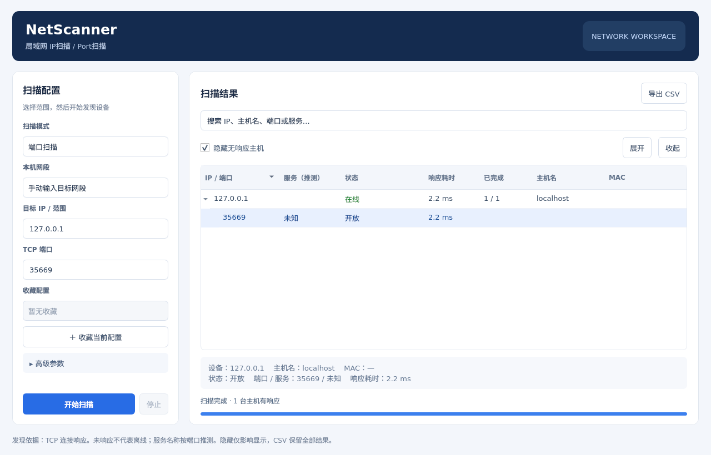

# NetScanner

面向 Ubuntu 的局域网 IP 发现与 TCP 端口扫描桌面软件，基于 C++17 与 Qt6 Widgets。



## 功能

- 扫描单个 IPv4、CIDR 网段或 IP 范围，支持多个目标并自动去重。
- IP 扫描：通过 TCP 响应发现主机；端口扫描：逐端口显示开放、关闭、超时或连接错误。
- 从本机网卡快速选择网段；可调连接超时与并发数；可随时停止并保留已完成结果。
- 树形结果按 IP / 端口数值排序，支持搜索、隐藏无响应主机、展开与收起。
- 异步查询主机名，读取本机 ARP 表中的 MAC 地址，按常见端口标注服务名称。
- 收藏扫描配置；导出 CSV；双击开放的 HTTP / HTTPS / FTP 端口用系统默认应用打开。

## 快速开始

Ubuntu 22.04 / 24.04：

```bash
sudo apt install build-essential cmake ninja-build qt6-base-dev libgl-dev
cmake -S . -B build -G Ninja -DCMAKE_BUILD_TYPE=Release
cmake --build build --parallel
./build/netscanner
```

安装到当前用户后，可在系统应用列表中启动 **NetScanner**：

```bash
cmake --install build --prefix "$HOME/.local"
```

## 文档

- [安装与部署](docs/INSTALL.md)：依赖、构建、安装、Flatpak 与 CI 产物。
- [使用指南](docs/USAGE.md)：输入格式、扫描模式、结果含义、收藏与导出。
- [测试](docs/TESTING.md)：自动测试内容与运行方法。
- [更新记录](CHANGELOG.md)

## 范围说明

NetScanner 使用 TCP Connect 探测，不需要 root 权限。主机仅响应 ICMP / ARP、或屏蔽了所选端口时，IP 扫描无法发现它，因此“未响应”不等于离线。服务名称按端口惯例推测，不做协议或版本识别。

当前支持 IPv4 TCP，不支持 IPv6、UDP、SYN 扫描与操作系统识别。单次扫描最多 4096 个主机、200000 次端口探测。

请只扫描你拥有或已获授权的网络。

## 许可证

[MIT](LICENSE)
